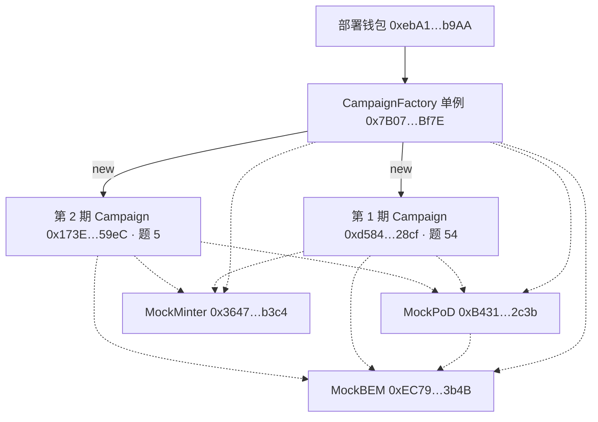

# BEM 众筹挖矿合约（Solidity）

把前端 `frontend/src/fixtures.js` 模拟的状态机与资金流，落成可部署的链上合约。**单一真相源**思想不变：前端每个 `apply*` 写函数在这里都有对应的链上函数，语义一一对应。

> 依赖外部系统（PoD 挖矿合约、BEM 代币、tapeout.net 晶体管铸造器）均以接口注入，`mocks/` 提供可测替身。晶体管二级市场无法被合约自动下单，仍由 **Owner 手动发起链上交易**（`placeTransistorOrder / confirmTransistors`）。

**功能目录（按场景 / 角色对照前端入口）**：见 [`FEATURES.md`](FEATURES.md)。

**测试网地址怎么串起来**：见 [§7 合约地址](#7-合约地址bsc-测试网-chainid-97)。

---

## 0. 状态机（与前端一致）

```
   buy 自然售罄                 execute（晶体管 ready + 观察期满）
┌──────────┐ ───────────────► ┌──────────┐ ─────────────────────────────► ┌──────────┐
│ funding  │                  │ executing│                                 │ mining   │
│ 募集中   │                  │ 待执行    │                                 │ 挖矿中   │
└────┬─────┘                  └────┬─────┘                                 └──────────┘
     │ 募集超时未售罄                │ 流片失败（executionFailed）
     ▼                             ▼
  refund（原路退 BNB，份额清零）  refund（本金尚未支出，原路退）

executing 子态：buying ──placeTransistorOrder──► listed ──confirmTransistors──► ready ──execute──► mining
                     ◄──cancelTransistorOrder──
mining 内唯一主动退出：份额转让 listShares / cancelListing / takeListing
```

- **退出两条互不相交路径**：份额转让（主动，仅 `mining`）+ 退款（被动安全阀，仅募资超时 / 流片失败）。合约**不提供本金或收益赎回**。
- `execute` **不可逆、仅 Owner**（F3）：按**锁定报价快照** `priceLock` 结算，避免被抢跑/抬价；成功清脏状态（F5）。

---

## 1. 资金闭环（F4：BNB 原子结算）

| 动作 | BNB 流向 | 账本字段 |
|---|---|---|
| `buy` | 买方 → 合约托管 | `raisedBnb += msg.value` |
| `takeListing` | 买方 → **实时付给卖方**（不进托管） | 卖方 `+pay`（`call` 转出） |
| `refund` | 合约 → 认购地址 | `raisedBnb −= amount`，`refunded[addr] += amount` |
| `execute` 成功 | 合约 → 晶体管铸造器 | `raisedBnb −= cost` |

- `raisedBnb` 显式记账，`receive()` 直接 revert，保证「合约 BNB 余额 == 托管池」不被直接转账污染。
- 二级市场 BNB **不进托管**，成交即过手，杜绝"只过户份额不结钱"。

---

## 2. 收益账本按地址隔离（F1）

- `shares / escrow / claimed / refunded` 全部按地址 `mapping` 记。
- `pendingBem(addr) = 每轮净产出 × harvestCount × shares[addr] / totalShares − claimed[addr]`，与前端 `computeHarvest(round, book, address)` 同口径。
- `harvest()` = 全网按份分发（从 PoD 拉当日 BEM、扣服务费打给收费地址、净额累计）；`claim()` = 只领**本钱包** pending。**领取次数不设上限**，只要还在出矿（`dailyBem() > 0`）。
- 产出口径移植自 `frontend/src/emission.js`：`dailyBem = H × 日产 × 池分成 / 全网权重`；`capped`（被挖矿闸门拦住）→ 未验证池只分 1%。全网权重由 Owner 通过 `updateNetworkWeight` 用 oracle 刷新。

---

## 3. 前端 `apply*` ↔ 合约函数映射

| 前端 `fixtures.js` | 合约 `Campaign.sol` | 权限 / 场景 |
|---|---|---|
| `applyBuy` | `buy(count)` | funding + 精确付款 + 不超剩余；售罄转 executing |
| `applyRefund` | `refund()` | 仅募资超时 / 流片失败；退本钱包 |
| `applyListShares` | `listShares(count, price)` | 仅 mining；挂单即 escrow 锁定 |
| `applyCancelListing` | `cancelListing(id)` | 仅挂单方 / Owner；释放锁定 |
| `applyTakeListing` | `takeListing(id, count)` | 仅 mining；不能接自己单；BNB 原子付卖方 |
| `applyPlaceTransistorOrder` | `placeTransistorOrder(count, unitPrice)` | 仅 Owner；executing；buying→listed；锁价 |
| `applyCancelTransistorOrder` | `cancelTransistorOrder()` | 仅 Owner；listed→buying；清锁价 |
| `applyConfirmTransistors` | `confirmTransistors()` | 仅 Owner；listed→ready |
| `applyExecute` | `execute(tapeoutData, startData)` | **仅 Owner** + ready + 观察期满 + 网表匹配；锁价结算；买不起→失败可退 |
| `applyHarvest` | `harvest()` | 仅 mining；全网分发；次数不限 |
| `applyClaim` | `claim()` | 仅 mining；领本钱包 pending |
| `createScene / ROUND` | `CampaignFactory.createCampaign(...)` | 仅 Factory Owner；参数写入不可改 |

---

## 4. 文件

| 文件 | 职责 |
|---|---|
| `Campaign.sol` | 单期主合约：状态机、认购、退款、转让市场、晶体管挂单、execute、harvest/claim、多钱包账本 |
| `CampaignFactory.sol` | 开期工厂：仅 Owner `createCampaign`，注入 PoD/BEM/Minter |
| `libraries/Emission.sol` | 产出口径（`emission.js` 上链移植） |
| `interfaces/` | `IERC20`(BEM) / `IPoD` / `ITransistorMinter` |
| `access/Ownable.sol` `security/ReentrancyGuard.sol` | 最小自包含基座（无外部依赖） |
| `mocks/` | `MockBEM` / `MockPoD` / `MockMinter` 测试替身 |
| `test/Campaign.test.js` | Hardhat 测试（覆盖状态机/越权/退款/转让/execute/harvest） |
| `scripts/deploy.js` | 部署 + 开一期示例 |

---

## 5. 开发与验证

```bash
cd D:/Code/miner/contracts
npm install                 # 安装 hardhat + toolbox
npx hardhat compile         # 编译（0.8.24，optimizer + viaIR）
npx hardhat test            # 跑逻辑测试（EVM 实跑）
```

- 也可用 `compile.mjs`（裸 solc）做无依赖编译校验：`node compile.mjs`。
- 测试镜像前端 `verify.mjs` 的分组：开期权限、认购校验、售罄转态、退款双触发、转让市场 BNB 原子结算、execute 硬闸门（未到账/观察期/非 Owner/网表不匹配）、execute 成败分支、harvest/claim 按地址隔离、领取无上限、产出口径。

---

## 6. 与真实集成的注意点

1. **PoD**：`harvest` 从 PoD `claim()` 拉 BEM，`execute` 调 PoD `start()` 返回权重 H。需 PoD 授权本合约领取。
2. **晶体管铸造器**：`mint(count)` 为 payable，实现方须校验 `msg.value == count × 锁定单价`，保证报价快照生效。
3. **全网权重**：`dailyBem` 依赖 `netWeightVerified/Unverified`，零和机制下需 oracle 定期 `updateNetworkWeight`。
4. **execute 余量**：流片只支出 `transistorCount × priceLock`，募集款余量留在 `raisedBnb`（未做 pro-rata 退回，与前端一致）；如需退回余量另加函数。
5. **转让追溯计息**：`pending` 按「当前份额 × 全部已 harvest 轮数」算，未按轮次快照，二级买家会被追溯计入买入前轮次（与前端同一演示简化）。

---

## 7. 合约地址（BSC 测试网，chainId 97）

快照日期 2026-10-17。部署记录在 `contracts/deployments/bscTestnet.json`，前端副本是 `frontend/src/chain/deployments.json`。第 2 期只登记在工厂的 `campaigns[]` 里，部署文件的 `campaign` 字段仍是第 1 期。

部署钱包同时 Factory Owner、两期 Owner、两期服务费收费地址：`0xebA1B24d36487a75C533233A07D6899a268Bb9AA`。



开期时工厂把当时的 `pod`、`bem`、`minter`、`owner`、`feeRecipient` 写进这一期。`bem` 和 `minter` 不能按期更换；`pod` 传 `0` 就用工厂默认；收费地址每一期单独填写。

### 地址落在哪一层

| 角色 | 地址 | 怎么绑上 | 链上代码 |
|---|---|---|---|
| 部署者 / Factory Owner / 两期 Owner / 两期收费地址 | `0xebA1B24d36487a75C533233A07D6899a268Bb9AA` | 同一个外部账户。收费地址按期写入，目前两期都填了这个钱包 | 0 字节 |
| CampaignFactory | `0x7B07673F48D12B1599658eCfbF2Ad1927c7FBf7E` | 单例。immutable 保存 pod、bem、minter；`campaigns[]` 登记每一期 | 12,216 字节 |
| MockPoD | `0xB4315F55CD614d09092f0Fcf75ef34C5ee252c3b` | 工厂默认挖矿合约。开期时 pod 传 0 就用它；它自己再指向 MockBEM | 742 字节 |
| MockMinter | `0x3647c71F0B947fd3CFAcF480Ab5a723dF18Bb3c4` | 晶体管铸造替身。创建参数不能按期更换，两期都是这个地址 | 444 字节 |
| MockBEM（实际在用） | `0xEC792B857613AC428dedCB7Bcec3F564B9833b4B` | 工厂与两期的 `bem()`。测试网部署时改布的模拟代币 | 1,296 字节 |
| 配置里的 BEM（未接入） | `0x5ce033b2bfca3af30b3e8c8457deaf776a8b695a` | `deployments.json` 的 `bemConfigured`。测试网该地址没有代码，没有任何合约指向它 | 0 字节 |
| 第 1 期 Campaign | `0xd5843D00f84518D67F88497D488438d7662d28cf` | `factory.campaigns(0)`。部署文件的 `campaign` 只记了这一期。taskId 54 | 9,151 字节 |
| 第 2 期 Campaign | `0x173EB17cA8e58d7249AAF534ec5099baFf4859eC` | `factory.campaigns(1)`。只存在于工厂数组，部署文件没有单独字段。taskId 5 | 9,151 字节 |

**全系统只此一份。** Factory、MockPoD、MockBEM、MockMinter 各部署一次，后面每一期都复用。`createCampaign` 里的 bem、minter 固定取工厂上的地址；只有 pod 可以传非零地址覆盖默认 PoD；收费地址按期填写。

**每一期各有一份。** 每次 `createCampaign` 都会 `new` 一份 Campaign，地址互相独立。BNB 托管和份额账本记在这一期自己的合约里。目前两期的差别是题目：第 1 期 taskId 54，第 2 期 taskId 5。单价 0.01 BNB、总份数 100、服务费 500 bps 相同。创建时 Owner  Factory Owner 复制；之后若转让所有权，就 Factory Owner 分开。

### 本地 Hardhat 是另一套地址

`contracts/deployments/hardhat.json`（chainId 31337，2026-10-17 07:57）和测试网文件结构相同，地址完全不同，两边没有互相引用。

| 角色 | Hardhat | BSC 测试网 |
|---|---|---|
| 部署者 | `0xf39Fd6e51aad88F6F4ce6aB8827279cffFb92266` | `0xebA1B24d36487a75C533233A07D6899a268Bb9AA` |
| Factory | `0xDc64a140Aa3E981100a9becA4E685f962f0cF6C9` | `0x7B07673F48D12B1599658eCfbF2Ad1927c7FBf7E` |
| PoD | `0x9fE46736679d2D9a65F0992F2272dE9f3c7fa6e0` | `0xB4315F55CD614d09092f0Fcf75ef34C5ee252c3b` |
| BEM | `0x5FbDB2315678afecb367f032d93F642f64180aa3` | `0xEC792B857613AC428dedCB7Bcec3F564B9833b4B` |
| Minter | `0xCf7Ed3AccA5a467e9e704C703E8D87F634fB0Fc9` | `0x3647c71F0B947fd3CFAcF480Ab5a723dF18Bb3c4` |
| 当时记下的第 1 期 | `0x856e4424f806D16E8CBC702B3c0F2ede5468eae5` | `0xd5843D00f84518D67F88497D488438d7662d28cf` |

### 前端实际用哪一个

`frontend/src/chain/deployments.json` 与测试网部署文件一致。期次列表和切换读的是工厂 `allCampaigns()`，所以能看到第 2 期。JSON 里的 `campaign` 只是第 1 期的快照。`bem` 是 MockBEM。`bemConfigured`（`0x5ce033b2bfca3af30b3e8c8457deaf776a8b695a`）在 BSC 测试网上没有字节码，部署脚本因此另布了 MockBEM，工厂和两期都指向这份模拟代币。
